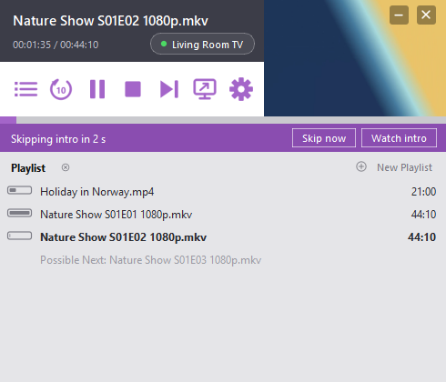
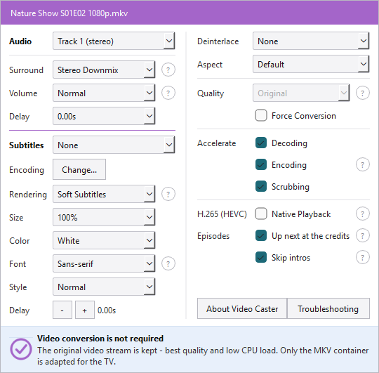

# Video Caster

Play the videos on your Windows PC on your TV - a Chromecast, a TV with Chromecast built-in,
Google TV or an Apple TV. Drop videos on the window, pick the TV, press play.

Whatever the TV can't play by itself (H.265 10-bit, odd containers, DTS audio, picture
subtitles, ...) is converted on the fly while it plays, on the graphics chip when the PC has
one. You can still skip and rewind with the app or with the TV remote.

<p align="center">
  
</p>

## Features

**Playback**
- Plays files directly when the TV supports them; otherwise converts them with FFmpeg while
  they play - with Intel Quick Sync when available, else on the processor (x264).
- Converted videos are sent as HLS in 4-second pieces made on request, so skipping anywhere
  is quick, from the app or the TV remote.
- Adaptive quality (1080p, 720p, 480p): on weak Wi-Fi the TV lowers the picture quality instead
  of stalling.
- Keeps an eye on the TV: if its player gets stuck (sound but no picture) the app restarts it
  and carries on where you were. A slow connection is recognised as such.
- Remembers where you stopped in every video and marks videos as watched.
- Speed test of the connection to the TV.

**Audio**
- Choose the audio track by language and format, e.g. *English (DD+ Atmos, 5.1)*.
- Stereo downmix, 5.1 surround, or **Dolby passthrough**: Dolby Digital and Dolby Digital Plus
  (Atmos included) go to your soundbar or receiver untouched; DTS, TrueHD and AAC 5.1 are sent
  as Dolby Digital 5.1.
- Volume boost or normalize (evens out loud and quiet scenes), audio delay.

**Subtitles**
- Subtitles inside the video and `.srt` / `.vtt` files next to it (or in a `Subs` or
  `Subtitles` folder), listed by language.
- Remembers your subtitle language, so the next episodes start with the same.
- Drawn by the TV (size, colour, font and style change live), or burned into the picture -
  also for picture-based subtitles such as PGS.
- Delay and character set adjustable.
- **Search online**: find and download subtitles from OpenSubtitles, matched to your exact file -
  no account needed (see [Online subtitles](#online-subtitles)).

**Series**
- **Possible Next**: the next episode in the folder is suggested under the playlist and plays
  after the last video.
- **Up next**: when the end credits start (found from the picture), a 10-second countdown shows
  in the window and on the TV, then an *Up next* card while the next episode loads.
- **Skip intros**: a series' opening titles are found by comparing the sound of two episodes in
  the same folder; when they start, a 5-second countdown skips them.
- Pause with the TV remote during a countdown to cancel it. Both can be switched off.

**TVs**
- Chromecast, Google TV and TVs with Chromecast built-in - found automatically on your network.
- Apple TV / AirPlay: play, pause, seek and volume. Soft subtitles aren't available there (use
  *Burned In*). Less tested than Chromecast.

## Requirements

- Windows 10 or 11 (developed and tested on Windows 11)
- Python 3 (tested with 3.15) - from [python.org](https://www.python.org/downloads/) or the Microsoft Store
- [FFmpeg](https://ffmpeg.org) with `ffmpeg` and `ffprobe` on the PATH. The Gyan build from winget
  has everything, including Chromaprint for *Skip intros*:
  ```powershell
  winget install Gyan.FFmpeg
  ```
- The PC and the TV on the same network

## Install and run

```powershell
git clone https://github.com/TVAVAE/video-caster.git
cd video-caster
python -m venv .venv
.venv\Scripts\activate
pip install -r app\requirements.txt
python app\main.py
```

You can also pass videos or folders: `python app\main.py "D:\Series\Some Show"`.
Other options: `--state <file>` (use another settings file), `--no-discovery` (don't look for
TVs), `--screenshot <file.png>` (save a picture of the window and exit).

The first time, Windows may ask whether Python may use the network: allow it on **private
networks** - the TV fetches the video from a small web server in the app.

## How to use

1. Click the **TV button** (top right) and pick your TV. It shows a picture to confirm it's
   connected; the TV menu also has volume, mute, *Disconnect* and *Speed Test*.
2. **Drag videos or folders** onto the window, or right-click the playlist: *Add videos...*,
   *Add a folder...*. Make more playlists with *New Playlist*.
3. **Double-click** a video to play it. Use the buttons, the seek bar - or your TV remote.
4. The **gear button** opens the settings for the selected video:

<p align="center">
  
</p>

The bar at the bottom of the settings says whether the video is played as it is or converted,
and why. Every option has a **?** with an explanation. A few worth knowing:

| Setting | What it does |
| --- | --- |
| H.265 (HEVC) *Native Playback* | Sends H.265 video without converting it. Turn on if your TV plays H.265 itself. |
| *Quality* | Picture size when converting - lower it if playback stutters. |
| *Force Conversion* | Converts even when the TV could play the file (e.g. if it plays badly). |
| *Accelerate* | Use the graphics chip for converting; *Scrubbing* shows previews while dragging the seek bar. |
| *Up next at the credits* / *Skip intros* | Switch the series countdowns on or off. |

### Keyboard

| Key | Action |
| --- | --- |
| Space | Play / pause |
| Left / Right | Back 10 s / forward 30 s |
| Ctrl+Up / Ctrl+Down | TV volume |
| Enter | Play the selected video |
| Delete | Remove from the playlist |
| Ctrl+O | Add videos |

Right-click a video in the playlist for more: play from the beginning, mark as (not) watched,
find subtitles online, show in Explorer.

## Online subtitles

Choose **Search online...** in the subtitle list, or right-click a video and choose
**Find subtitles online...**. No account or sign-up is needed.

1. The search starts straight away in your usual subtitle language; pick another language and
   press *Search* if you like. Subtitles made for exactly your file are marked with ✓ and listed
   first, then ones for the same release. If there are none in your language, the window says
   which languages do have some.
2. **Download & use** (or double-click) saves the file next to the video as
   `<video name>.<language>.online.srt` and switches to it straight away. Next time the app
   finds it by itself.

The subtitles come from OpenSubtitles through the free service the Stremio media player uses
(its *OpenSubtitles v3* add-on and its *Cinemeta* catalogue, to look up the IMDb id of a film or
series from the file name). That service is made for Stremio, so it could change at any time.

**Optional - your own OpenSubtitles API key.** Under **Account...** you can add an API key from
your own (free) OpenSubtitles account: sign up at [opensubtitles.com](https://www.opensubtitles.com),
open [API consumers](https://www.opensubtitles.com/consumers) in your profile and create one.
The search then also asks the official OpenSubtitles API: more results, with download counts.
User name and password are optional too - logged in, you get more downloads per day. They are
stored in `app/state.json`, encrypted for your Windows account (Windows' own DPAPI). Empty the
key and press *Save* to stop using it.

## Privacy

Everything stays on your own network: the app talks only to your TVs. Only when you use the
online subtitle search, the video's file name, size and fingerprint (OpenSubtitles' file hash)
are sent to Stremio's subtitle service (`strem.io`) - and to OpenSubtitles.com if you added
your own API key.

## Files

| Path | What |
| --- | --- |
| `app/main.py` | The window (PySide6 / Qt) |
| `app/backend.py` | The engine: finding TVs, the media server, deciding how to play each file, FFmpeg, HLS, subtitles, credits and intro detection, OpenSubtitles |
| `app/state.json` | Your playlists, settings and watch progress (created on first run) |
| `app/cache/` | Converted pieces, thumbnails, extracted subtitles - can be emptied while the app is closed |
| `app/videocaster.log` | What happened during playback - handy when something goes wrong |

The last three are personal or temporary and are kept out of git by `.gitignore`.

## Troubleshooting

- **The TV isn't listed** - check that the PC and the TV are on the same network, then use
  *Search again* in the TV menu.
- **The TV shows nothing or can't load the video** - allow Python through Windows Firewall on
  private networks. *Troubleshooting* (in the settings) shows the address the TV must reach.
- **Sound but no picture** - the app normally restarts the TV's player by itself; if not,
  *Disconnect* and connect again.
- **No sound with Passthrough** - your TV or soundbar doesn't take Dolby; choose *Stereo Downmix*.
- **Playback stutters** - run the *Speed Test*, or set *Quality* lower. On a weak connection the
  app switches to adaptive streaming by itself.
- Details are in `app/videocaster.log`; *Troubleshooting* in the settings shows the setup and
  lets you copy it.

## For developers

For testing there are two environment variables:

- `VIDEOCASTER_THROTTLE_KBPS` - slows the media server down, to try weak connections.
- `VIDEOCASTER_STREMIO_SUBS`, `VIDEOCASTER_CINEMETA`, `VIDEOCASTER_OS_API` - point the subtitle
  search at other servers (e.g. local stand-ins).

Built with [PySide6](https://doc.qt.io/qtforpython-6/), [pychromecast](https://github.com/home-assistant-libs/pychromecast),
[pyatv](https://pyatv.dev), [NumPy](https://numpy.org), [FFmpeg](https://ffmpeg.org) with
[Chromaprint](https://acoustid.org/chromaprint); subtitles from [OpenSubtitles](https://www.opensubtitles.com),
through [Stremio](https://www.stremio.com)'s add-ons or the [OpenSubtitles.com API](https://opensubtitles.stoplight.io).
